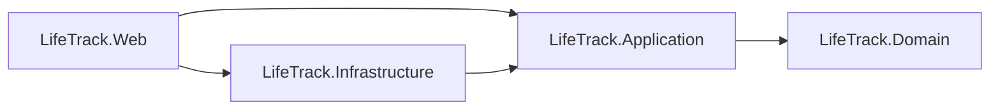

# LifeTrack

Finanzas personales con dashboard inteligente. Proyecto final (TFM) de un máster de desarrollo con IA.
**.NET 10 · Clean Architecture · ASP.NET Core MVC · EF Core · Azure SQL (gratis) · OWASP Top 10:2025**

Este paquete contiene **solo la estructura de carpetas y los documentos de reglas**. El código lo genera la IA siguiendo esas reglas.

## Qué hay dentro

| Archivo | Contenido |
|---|---|
| [`AGENTS.md`](AGENTS.md) | Reglas para la IA: arquitectura, clean code, seguridad, EF, pruebas, receta, DoD y prohibiciones |
| `src/*/AGENTS.md`, `tests/AGENTS.md` | Reglas específicas de cada capa |
| [`.github/copilot-instructions.md`](.github/copilot-instructions.md) | Instrucciones específicas para Copilot, alineadas con `AGENTS.md` |
| [`docs/01-especificacion.md`](docs/01-especificacion.md) | Especificación funcional: requisitos, reglas de negocio, historias, RNF, modelo de datos, fases |
| [`docs/02-arquitectura.md`](docs/02-arquitectura.md) | Capas, dependencias, flujo de una petición, convenciones |
| [`docs/03-seguridad-owasp.md`](docs/03-seguridad-owasp.md) | OWASP Top 10:2025 → controles, reglas para la IA, verificación, checklist de PR |
| [`docs/04-calidad-y-testing.md`](docs/04-calidad-y-testing.md) | Clean code, puertas de calidad, estrategia de pruebas, CI |
| [`docs/05-flujo-con-ia.md`](docs/05-flujo-con-ia.md) | Contexto y controles del proyecto para el flujo gestionado con gentle-ai |
| [`docs/06-despliegue-azure.md`](docs/06-despliegue-azure.md) | Recursos gratuitos, App Settings, migraciones, CI/CD con OIDC |
| [`docs/07-patrones-de-referencia.md`](docs/07-patrones-de-referencia.md) | Índice de ejemplos por configuración, capa y tests |
| [`docs/08-estandar-javascript.md`](docs/08-estandar-javascript.md) | Patrón IIFE, constantes obligatorias, componentes compartidos, prohibiciones |
| [`docs/09-estandar-vistas-mvc.md`](docs/09-estandar-vistas-mvc.md) | Controllers, `ViewModels`, vistas sin lógica, parciales, layout, accesibilidad |
| [`docs/adr/`](docs/adr) | Decisiones de arquitectura |

## Estructura

```
src/LifeTrack.Domain          entidades y reglas (sin dependencias)
src/LifeTrack.Application     casos de uso e interfaces (solo Domain)
src/LifeTrack.Infrastructure  EF Core, Identity, repositorios
src/LifeTrack.Web             Controllers · ViewModels · vistas Razor y composición
tests/                        Domain.Tests · Application.Tests · Architecture.Tests · Integration.Tests
```

## Cómo empezar

### Opción A — con gentle-ai (recomendada)
Usa gentle-ai para orquestar el flujo de trabajo. Este repositorio aporta el contexto específico de LifeTrack: los requisitos están en `docs/01-especificacion.md`, la arquitectura en `docs/02-arquitectura.md` y las reglas globales y por capa en `AGENTS.md`.

La guía [`docs/05-flujo-con-ia.md`](docs/05-flujo-con-ia.md) reúne las decisiones y verificaciones del proyecto que acompañan ese flujo. No duplica sus fases ni sus prompts.

### Opción B — a mano (Fase 0)
```bash
dotnet new sln --format sln -n LifeTrack
dotnet new classlib -n LifeTrack.Domain         -o src/LifeTrack.Domain         -f net10.0
dotnet new classlib -n LifeTrack.Application    -o src/LifeTrack.Application    -f net10.0
dotnet new classlib -n LifeTrack.Infrastructure -o src/LifeTrack.Infrastructure -f net10.0
dotnet new mvc     -n LifeTrack.Web            -o src/LifeTrack.Web            -f net10.0
dotnet new xunit    -n LifeTrack.Domain.Tests       -o tests/LifeTrack.Domain.Tests       -f net10.0
dotnet new xunit    -n LifeTrack.Application.Tests  -o tests/LifeTrack.Application.Tests  -f net10.0
dotnet new xunit    -n LifeTrack.Architecture.Tests -o tests/LifeTrack.Architecture.Tests -f net10.0
dotnet new xunit    -n LifeTrack.Integration.Tests  -o tests/LifeTrack.Integration.Tests  -f net10.0

dotnet add src/LifeTrack.Application    reference src/LifeTrack.Domain
dotnet add src/LifeTrack.Infrastructure reference src/LifeTrack.Application
dotnet add src/LifeTrack.Web            reference src/LifeTrack.Application src/LifeTrack.Infrastructure
dotnet add tests/LifeTrack.Domain.Tests       reference src/LifeTrack.Domain
dotnet add tests/LifeTrack.Application.Tests  reference src/LifeTrack.Application
dotnet add tests/LifeTrack.Architecture.Tests reference src/LifeTrack.Domain src/LifeTrack.Application src/LifeTrack.Infrastructure src/LifeTrack.Web
dotnet add tests/LifeTrack.Integration.Tests  reference src/LifeTrack.Web

dotnet sln add (Get-ChildItem -Recurse src,tests -Filter *.csproj)    # PowerShell
# bash:  dotnet sln add $(find src tests -name '*.csproj')
```
Luego copia las plantillas de [`docs/referencias/configuracion.md`](docs/referencias/configuracion.md) (`global.json`, `Directory.Build.props`, `Directory.Packages.props`, `.editorconfig`, `.gitignore`, `docker-compose.yml`) y quita los atributos `Version=` de los `PackageReference` generados por las plantillas (las versiones viven en `Directory.Packages.props`). Elimina los archivos de ejemplo (`Class1.cs`, `UnitTest1.cs`, páginas de plantilla).

### Entorno local (cuando haya código)
```bash
echo 'MSSQL_SA_PASSWORD=<contraseña-fuerte>' > .env   # el archivo .env no se sube (.gitignore)
docker compose up -d
dotnet user-secrets set "ConnectionStrings:DefaultConnection" "<cadena>" --project src/LifeTrack.Web
dotnet dev-certs https --trust
dotnet run --project src/LifeTrack.Web --launch-profile https
```
Las plantillas de configuración (incluido `.env.example`) están en [`docs/referencias/configuracion.md`](docs/referencias/configuracion.md).

## Requisitos funcionales (resumen)

| Área | Funcionalidad | Prioridad |
|---|---|---|
| **Cuenta** | Registro/login, bloqueo 5 intentos, aislamiento de datos, borrado de cuenta | M / S |
| **Finanzas** | Categorías (CRUD), movimientos (CRUD), resumen mensual, presupuestos con avisos 80 %/100 %, importación CSV | M / S / C |
| **Dashboard** | Resumen mes, proyección saldo fin de mes, alertas gasto inusual (≥ 2.5× media, mínimo 5 movimientos) | M / S |
| **Extras** | *No implementados (prioridad C)*: recordatorio diario (Azure Function), sugerencia categoría con IA (fallback reglas) | C |

Ver detalle completo en [`docs/01-especificacion.md`](docs/01-especificacion.md#3-requisitos-funcionales).

## Presentación

[Ver presentación online](https://html-preview.github.io/?url=https://github.com/evertabor/LifeTrack/blob/main/docs/presentacion-lifetrack.html) — 8 diapositivas (HTML autocontenido).
<br>
[Archivo local](docs/presentacion-lifetrack.html) — para abrir directo en el navegador.

## Reglas de negocio clave

- **Monto**: > 0, ≤ 1.000.000.000, máx 2 decimales
- **Fecha**: no futura (respecto a "hoy" en zona `App:TimeZoneId`)
- **Categoría**: nombre único por usuario (≤ 50), tipo fijo (Ingreso/Gasto)
- **Presupuesto**: único por usuario + categoría + año + mes, solo categorías de gasto
- **Aislamiento**: cada usuario solo ve sus datos; id ajeno = "no encontrado"
- **Borrado**: eliminar usuario borra en cascada todas sus entidades

## Requisitos no funcionales (resumen)

| ID | Categoría | Requisito |
|---|---|---|
| RNF-01 | Seguridad | OWASP Top 10:2025, autorización denegar-por-defecto, aislamiento, CSP, secretos fuera |
| RNF-02 | Privacidad | Datos mínimos, sin PII en logs, borrado total |
| RNF-03 | Rendimiento | < 1 s páginas principales (tras calentamiento); arranque en frío documentado |
| RNF-05 | Costo | **0 USD/mes**: App Service F1 + Azure SQL free offer |
| RNF-06 | Mantenibilidad | Clean Architecture verificada por tests; sin warnings; cobertura medida y reportada |
| RNF-09 | Accesibilidad | HTML semántico, `label` en campos, contraste, teclado, WCAG 2.2 AA |
| RNF-12 | Cadena de suministro | Versiones centralizadas, auditoría NuGet, Dependabot, CodeQL |

## Arquitectura (resumen)



- **Domain**: entidades, invariantes, `DomainException`, `NotFoundException` — cero dependencias externas
- **Application**: contratos (`ICommand<T>`, `IQuery<T>`, `IRequest`), handlers `sealed`, interfaces (`I…Repository`, `IUnitOfWork`, `ICurrentUser`), `MediatR` 13.* (único NuGet)
- **Infrastructure**: `DbContext`, configuraciones EF, migraciones, repositorios, Identity, `TimeProvider`
- **Web**: controllers delgados (`ISender` + `ILogger`), `InputModel`/`ViewModel`, vistas Razor **sin lógica**, TagHelpers, cabeceras de seguridad

Detalle en [`docs/02-arquitectura.md`](docs/02-arquitectura.md). Decisiones registradas en [`docs/adr/`](docs/adr).

## Seguridad (OWASP Top 10:2025)

1. **A01 Control de acceso**: política fallback = autenticado; filtro por `UserId` en cada consulta; test IDOR por handler
2. **A02 Configuración**: secretos en user-secrets / App Settings; CSP, HSTS, `AllowedHosts` restringido
3. **A03 Cadena de suministro**: versiones en `Directory.Packages.props`; `MediatR 13.*` aprobado; sin paquetes nuevos sin aprobación
4. **A04 Criptografía**: Identity (hash), Data Protection; HTTPS, cookies `HttpOnly/Secure/SameSite`
5. **A05 Inyección**: EF Core LINQ parametrizado; sin `Html.Raw` con datos de usuario; validación en `InputModel` y dominio
6. **A06 Diseño inseguro**: invariantes en dominio; rate limiting; `InputModel` dedicados (no over-posting)
7. **A07 Autenticación**: contraseña ≥ 12, bloqueo 5 intentos, mensajes genéricos
8. **A08 Integridad**: anti-forgery global (`AutoValidateAntiforgeryToken`); sin deserialización insegura; CI permisos mínimos
9. **A09 Registro**: logs estructurados (`ILogger` plantillas), eventos de seguridad, sin secretos/PII
10. **A10 Condiciones excepcionales**: falla cerrado, `CancellationToken` en I/O, reintentos solo transitorios

Ver [`docs/03-seguridad-owasp.md`](docs/03-seguridad-owasp.md) para checklist completa y verificación.

## Despliegue (coste cero)

| Recurso | Configuración |
|---|---|
| **Cómputo** | Azure App Service plan F1 (Linux, .NET 10) |
| **Datos** | Azure SQL Database free offer (serverless con autopausa) |
| **CI/CD** | GitHub Actions con OIDC federado hacia Azure |
| **Secretos** | App Settings del App Service; local: `dotnet user-secrets` |
| **Migraciones** | Generadas en pipeline, ejecutadas en despliegue (no automáticas en prod) |

Detalle en [`docs/06-despliegue-azure.md`](docs/06-despliegue-azure.md).

## Estado actual

| Verificación | Resultado |
|---|---|
| Build Release | ✅ 0 warnings · 0 errores |
| Tests Domain | ✅ 46 passed |
| Tests Application | ✅ 139 passed |
| Tests Architecture | ✅ 11 passed |
| Tests Integration | ✅ 59 passed |
| Tests Playwright | ⏭️ 2 skipped (requieren entorno) |
| **Total** | **255 tests passed** |
| `dotnet format --verify-no-changes` | ✅ |
| `dotnet list package --vulnerable` | ✅ limpio |

Última verificación local: **24/10/2026**.

## Principios no negociables

1. La especificación manda: nada se implementa si no está en `docs/01-especificacion.md`.
2. Las dependencias apuntan hacia dentro y un test lo comprueba.
3. Toda consulta filtra por el usuario actual.
4. Sin secretos en el repositorio; sin paquetes nuevos sin aprobación.
5. Nada se da por terminado sin `build + test + format`.
6. Las vistas solo renderizan: los datos llegan ya formateados desde el `ViewModel`.
7. En JavaScript, ningún selector ni literal fuera de los bloques de constantes.
8. Todo lo que ver con código en inglés; los textos visibles al usuario y la documentación en español.