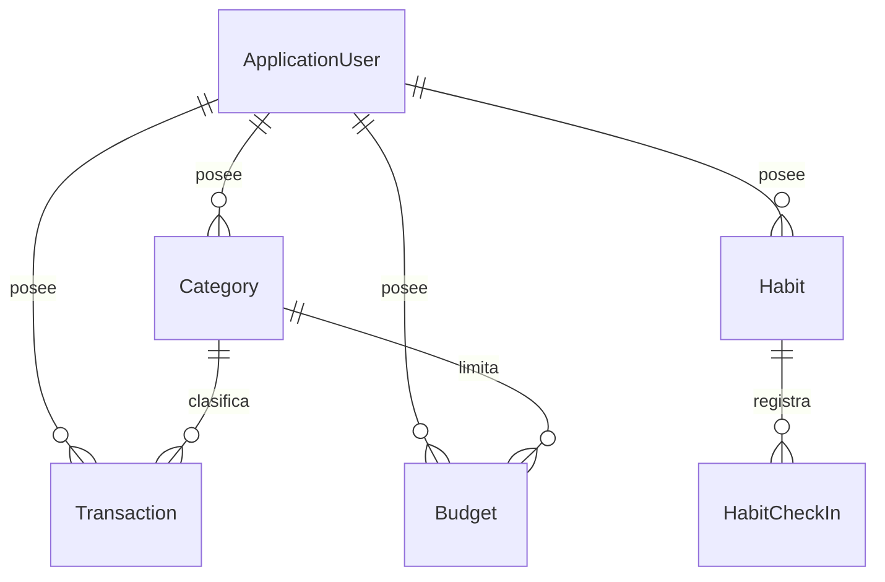
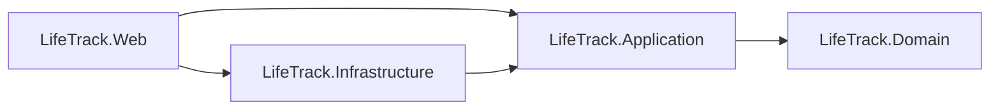

# LifeTrack — Documento de especificación

| | |
|---|---|
| **Proyecto** | LifeTrack: finanzas personales + hábitos, con dashboard cruzado |
| **Tipo** | Proyecto final (TFM) del máster de desarrollo con IA |
| **Versión** | 0.1 (borrador inicial) |
| **Estado** | Listo para empezar el flujo Spec-Driven Development |
| **Stack** | .NET 10, ASP.NET Core MVC (vistas Razor), EF Core, MediatR, Azure SQL (free offer), Identity, GitHub Actions |
| **Despliegue** | Azure, solo recursos de capa gratuita (App Service F1 + Azure SQL free offer) |

> Este documento es la **fuente de verdad funcional**. Un agente de IA (o una persona) no debe implementar nada que no figure aquí; si falta algo, se añade primero a este documento.

---

## 1. Introducción

### 1.1 Propósito
Construir una aplicación web **para uso personal** que permita (a) registrar ingresos y gastos con presupuesto mensual por categoría, (b) seguir hábitos diarios con rachas, y (c) ver ambos en un dashboard que **cruza hábitos con gasto** (p. ej. "los días que cocino en casa gasto menos en comida").

### 1.2 Objetivos del TFM
1. Demostrar un flujo de desarrollo asistido por IA basado en **especificaciones** (SDD), reglas para agentes (`AGENTS.md`) y puertas de calidad automáticas.
2. Aplicar **Clean Architecture** en .NET con reglas verificables por tests de arquitectura.
3. Aplicar **OWASP Top 10:2025** de forma concreta y verificable.
4. Desplegar con **CI/CD** en Azure a **coste cero**.

### 1.3 Alcance
**Dentro:** autenticación, finanzas (categorías, movimientos, presupuestos, resumen), hábitos (rachas, calendario), dashboard cruzado, despliegue, pruebas, documentación.
**Fuera (no se hará en el TFM):** conexión bancaria automática, multimoneda, aplicación móvil nativa, uso compartido entre usuarios, notificaciones push, cálculo de impuestos.

### 1.4 Glosario
| Término | Significado |
|---|---|
| **Check-in** | Registro de que un hábito se cumplió en una fecha |
| **Racha actual** | Días consecutivos con check-in que terminan hoy (o ayer, si hoy aún no se registró) |
| **Mejor racha** | La racha consecutiva más larga de la historia del hábito |
| **Movimiento** | Ingreso o gasto con monto, fecha y categoría |
| **Presupuesto** | Límite mensual de gasto para una categoría |
| **Hoy** | Fecha actual en la zona horaria configurada (`App:TimeZoneId`), no la del servidor |
| **IDOR/BOLA** | Acceder a datos de otro usuario manipulando un id |

### 1.5 Supuestos
- Un único usuario real (el autor), pero el sistema es **multiusuario** y aísla datos por usuario.
- Un solo idioma de interfaz (español) y una sola moneda (el símbolo no se persiste; se muestra el número con 2 decimales).
- Se usan datos de demostración en el repositorio; **nunca** datos financieros reales.

---

## 2. Actores
| Actor | Descripción |
|---|---|
| **Visitante** | Sin sesión. Solo puede ver registro, inicio de sesión y `/health` |
| **Usuario** | Autenticado. Gestiona únicamente sus propios datos |
| **Planificador (opcional)** | Tarea programada (Azure Function) que envía recordatorios |

---

## 3. Requisitos funcionales

Prioridad con MoSCoW: **M** (imprescindible), **S** (debería), **C** (podría).

### 3.1 Cuenta y autenticación
| ID | Requisito | Prio. |
|---|---|---|
| RF-A01 | Registro con correo y contraseña (mínimo 12 caracteres) | M |
| RF-A02 | Inicio y cierre de sesión; bloqueo temporal tras 5 intentos fallidos | M |
| RF-A03 | Cada usuario solo puede ver y modificar **sus** datos | M |
| RF-A04 | El usuario puede eliminar su cuenta y **todos** sus datos | S |
| RF-A05 | Confirmación de correo y/o segundo factor (MFA) | C |

### 3.2 Finanzas
| ID | Requisito | Prio. |
|---|---|---|
| RF-F01 | Crear, listar, renombrar y eliminar categorías (no se elimina si tiene movimientos) | M |
| RF-F02 | Registrar un movimiento (tipo, categoría, monto, fecha, descripción opcional) | M |
| RF-F03 | Listar los movimientos de un mes, con filtro por categoría | M |
| RF-F04 | Editar y eliminar un movimiento | S |
| RF-F05 | Resumen mensual: ingresos, gastos, balance y gasto por categoría | M |
| RF-F06 | Definir presupuesto mensual por categoría y mostrar su consumo (aviso al 80 % y al 100 %) | S |
| RF-F07 | Importar movimientos desde un CSV (con vista previa y validación) | C |

### 3.3 Hábitos
| ID | Requisito | Prio. |
|---|---|---|
| RF-H01 | Crear un hábito diario | M |
| RF-H02 | Listar hábitos con racha actual, mejor racha y estado de hoy | M |
| RF-H03 | Registrar check-in de hoy (y de fechas pasadas) | M |
| RF-H04 | Deshacer un check-in | S |
| RF-H05 | Archivar un hábito (conserva el historial, no admite nuevos check-ins) | S |
| RF-H06 | Calendario de calor de los últimos 90 días por hábito | S |

### 3.4 Dashboard
| ID | Requisito | Prio. |
|---|---|---|
| RF-D01 | Resumen del mes: ingresos, gastos, balance | M |
| RF-D02 | Hábitos con racha activa y pendientes de hoy | M |
| RF-D03 | **Correlación hábito–gasto:** para un hábito y una categoría, gasto medio diario los días con check-in frente a los días sin check-in | S |

### 3.5 Extras opcionales
| ID | Requisito | Prio. |
|---|---|---|
| RF-X01 | Recordatorio diario por Telegram/correo mediante Azure Function con temporizador | C |
| RF-X02 | Sugerencia automática de categoría con IA (con respaldo por reglas de palabras clave) | C |

---

## 4. Reglas de negocio
| ID | Regla |
|---|---|
| RN-F01 | El monto de un movimiento es mayor que 0, no supera 1.000.000.000 y tiene como máximo 2 decimales |
| RN-F02 | La fecha de un movimiento no puede ser futura (respecto a "hoy") |
| RN-F03 | La descripción tiene como máximo 200 caracteres; se recorta con `Trim` |
| RN-F04 | El nombre de categoría es obligatorio, de hasta 50 caracteres, y único por usuario |
| RN-F05 | Un movimiento solo puede usar categorías del mismo usuario |
| RN-F06 | Un presupuesto es único por usuario + categoría + año + mes, con límite > 0 y 2 decimales |
| RN-H01 | El nombre de un hábito es obligatorio y de hasta 80 caracteres |
| RN-H02 | Solo un check-in por hábito y día |
| RN-H03 | No se admiten check-ins en fechas futuras ni en hábitos archivados |
| RN-H04 | La racha actual cuenta días consecutivos hasta hoy; si hoy no está marcado pero ayer sí, la racha sigue viva |
| RN-H05 | Un hábito archivado no aparece en las listas, pero conserva su historial |
| RN-G01 | "Hoy" se calcula con la zona horaria `App:TimeZoneId` |
| RN-G02 | Eliminar un usuario elimina en cascada todos sus datos |

---

## 5. Historias de usuario y criterios de aceptación

**HU-01 — Registrarme** (RF-A01)
- *Dado* un visitante, *cuando* envía un correo válido y una contraseña de 12+ caracteres, *entonces* se crea la cuenta y queda con sesión iniciada.
- *Dado* una contraseña de menos de 12 caracteres, *entonces* se muestra un error y no se crea la cuenta.

**HU-02 — Proteger mi cuenta** (RF-A02)
- *Dado* 5 intentos fallidos seguidos, *entonces* la cuenta se bloquea 15 minutos.
- *Dado* credenciales incorrectas, *entonces* el mensaje no revela si el correo existe.

**HU-03 — Aislar mis datos** (RF-A03)
- *Dado* dos usuarios A y B, *cuando* A solicita un recurso de B por su id, *entonces* recibe "no encontrado" y **no se modifica nada**.
- *Dado* un visitante sin sesión, *cuando* abre cualquier página privada, *entonces* se le redirige al inicio de sesión.

**HU-04 — Gestionar categorías** (RF-F01)
- *Dado* un nombre nuevo, *cuando* lo guardo, *entonces* aparece en mi lista.
- *Dado* un nombre ya existente (ignorando espacios al borde), *entonces* veo "Ya existe una categoría con ese nombre".

**HU-05 — Registrar un gasto** (RF-F02, RN-F01..F05)
- *Dado* categoría propia, monto 25,50 y fecha de hoy, *entonces* el movimiento se guarda y aparece en el mes.
- *Dado* monto 0, negativo o con 3 decimales, *entonces* se rechaza con mensaje claro.
- *Dado* una fecha de mañana, *entonces* se rechaza.
- *Dado* una categoría de otro usuario, *entonces* se rechaza como "no válida".

**HU-06 — Ver el resumen del mes** (RF-F05, RF-D01)
- *Dado* ingresos 1000 y gastos 400 en el mes, *entonces* el balance mostrado es 600 y el desglose por categoría suma 400.
- *Dado* un mes sin movimientos, *entonces* se muestran ceros, sin errores.

**HU-07 — Controlar presupuesto** (RF-F06)
- *Dado* presupuesto 100 para "Comida" y gasto acumulado 80, *entonces* se muestra un aviso de consumo al 80 %.
- *Dado* gasto acumulado ≥ 100, *entonces* se muestra el aviso de presupuesto superado.

**HU-08 — Crear y marcar hábitos** (RF-H01..H03)
- *Dado* un nombre válido, *entonces* el hábito aparece con racha 0.
- *Dado* un hábito sin marcar hoy, *cuando* pulso "Marcar hoy", *entonces* la racha aumenta y el botón queda como "Hecho hoy".
- *Dado* un hábito ya marcado hoy, *entonces* un segundo intento muestra "ya está registrado" y no duplica.

**HU-09 — Rachas correctas** (RN-H04)
- *Dado* check-ins en hoy-1 y hoy, *entonces* racha actual = 2.
- *Dado* check-ins solo en hoy-2 y hoy-1, *entonces* racha actual = 2 (sigue viva).
- *Dado* check-ins en hoy-4 y hoy-3, *entonces* racha actual = 0 y mejor racha = 2.

**HU-10 — Cruzar hábitos y gasto** (RF-D03)
- *Dado* un hábito "Cocinar en casa" y la categoría "Restaurantes", *entonces* el dashboard muestra el gasto medio diario con y sin check-in, y el número de días de cada grupo.
- *Dado* menos de 7 días en alguno de los grupos, *entonces* se muestra "datos insuficientes" en lugar de un porcentaje engañoso.

**HU-11 — Borrar mis datos** (RF-A04, RN-G02)
- *Dado* un usuario autenticado, *cuando* confirma la eliminación de su cuenta, *entonces* desaparecen su cuenta, categorías, movimientos, presupuestos y hábitos.

---

## 6. Requisitos no funcionales

| ID | Categoría | Requisito |
|---|---|---|
| RNF-01 | Seguridad | Cumplir `docs/03-seguridad-owasp.md`: autorización denegar-por-defecto, aislamiento por usuario, cabeceras y CSP, secretos fuera del repositorio |
| RNF-02 | Privacidad | Solo se guardan los datos necesarios; no se registran datos personales en logs; el usuario puede borrar todo |
| RNF-03 | Rendimiento | Páginas principales < 1 s tras el "calentamiento". El arranque en frío (App Service F1 y Azure SQL serverless pausada) se acepta y se documenta |
| RNF-04 | Disponibilidad | *Best effort*. F1 no ofrece SLA; no hay requisitos de alta disponibilidad |
| RNF-05 | Costo | **0 USD/mes**: solo App Service F1 y Azure SQL free offer; sin recursos de pago |
| RNF-06 | Mantenibilidad | Clean Architecture verificada por tests; sin warnings; cobertura de `Domain` y `Application` medida y reportada en cada ejecución de CI, como dato exigido y no como objetivo a alcanzar. La cobertura no decide qué tests se escriben: esa decisión la toma el criterio de riesgo de `AGENTS.md` §10 |
| RNF-07 | Testabilidad | Reloj, usuario actual y repositorios inyectables; tests deterministas |
| RNF-08 | Observabilidad | Logs estructurados con `ILogger`; endpoint `/health`; identificador de solicitud visible en la página de error |
| RNF-09 | Accesibilidad | HTML semántico, `label` en todos los campos, contraste suficiente, uso con teclado, WCAG 2.2 nivel AA como objetivo |
| RNF-10 | Usabilidad | Diseño *mobile-first*, formularios con validación junto al campo, mensajes en español claros |
| RNF-11 | Portabilidad | Desarrollo local reproducible con `docker compose` (SQL Server) y `dotnet user-secrets` |
| RNF-12 | Cadena de suministro | Versiones centralizadas, auditoría NuGet, Dependabot, análisis CodeQL en CI |

---

## 7. Modelo de dominio y de datos

| Entidad | Atributos | Invariantes / índices |
|---|---|---|
| **Category** | `Id`, `UserId`, `Name(≤50)` | Nombre obligatorio; único por (`UserId`,`Name`) |
| **Transaction** | `Id`, `UserId`, `CategoryId`, `Type(Income/Expense)`, `Amount(18,2)`, `Date`, `Description(≤200)` | RN-F01..F03; índice (`UserId`,`Date`); FK a Category con `Restrict` |
| **Budget** | `Id`, `UserId`, `CategoryId`, `Year`, `Month`, `Limit(18,2)` | RN-F06; único por (`UserId`,`CategoryId`,`Year`,`Month`) |
| **Habit** *(raíz de agregado)* | `Id`, `UserId`, `Name(≤80)`, `IsArchived`, `CheckIns` | RN-H01..H05 |
| **HabitCheckIn** | `Id`, `HabitId`, `Date` | Único por (`HabitId`,`Date`) |

Todas las entidades de usuario tienen FK a `AspNetUsers` con borrado en cascada (RN-G02). Los ids se generan en el dominio (`Guid`).

---

## 8. Casos de uso (handlers de `Application`)

Cada caso de uso es un `Command` o un `Query` de **MediatR** con su handler: el contrato es un `record`
que implementa `ICommand<T>`, `IQuery<T>` o `IRequest`, y el handler es `sealed` e implementa
`IRequestHandler<,>` (o `IRequestHandler<>` si no devuelve nada). `Web` los envía por `ISender`.

| Caso de uso | Contrato + Handler | Requisitos | Prioridad de construcción |
|---|---|---|---|
| Crear categoría | `CreateCategoryHandler` | RF-F01, RN-F04 | Fase 2 |
| Listar categorías | `ListCategoriesHandler` | RF-F01 | Fase 2 |
| Registrar movimiento | `CreateTransactionHandler` | RF-F02, RN-F01..F05 | Fase 2 |
| Resumen/listado mensual | `ListMonthlyTransactionsHandler` | RF-F03, RF-F05, RF-D01 | Fase 2 |
| Editar/eliminar movimiento | `UpdateTransactionHandler`, `DeleteTransactionHandler` | RF-F04 | Fase 5 |
| Definir/consultar presupuesto | `SetBudgetHandler`, `GetBudgetStatusHandler` | RF-F06 | Fase 5 |
| Crear hábito | `CreateHabitHandler` | RF-H01 | Fase 3 |
| Marcar hábito | `CheckInHabitHandler` | RF-H03, RN-H02/H03 | Fase 3 |
| Listar hábitos con rachas | `ListHabitsHandler` | RF-H02, RF-D02 | Fase 3 |
| Deshacer check-in / archivar | `UndoCheckInHandler`, `ArchiveHabitHandler` | RF-H04, RF-H05 | Fase 5 |
| Correlación hábito–gasto | `GetHabitSpendingCorrelationHandler` | RF-D03 | Fase 5 |
| Eliminar mi cuenta | `DeleteAccountHandler` | RF-A04 | Fase 5 |

---

## 9. Arquitectura (resumen)

Detalle en `docs/02-arquitectura.md`. Decisiones registradas en `docs/adr/`.
Normas de la capa de presentación en `docs/09-estandar-vistas-mvc.md` y `docs/08-estandar-javascript.md`.

### Despliegue (coste cero)
- **Cómputo:** Azure App Service plan F1 (Linux, .NET 10).
- **Datos:** Azure SQL Database con la *free offer* (serverless con autopausa).
- **CI/CD:** GitHub Actions con autenticación federada (OIDC) hacia Azure.
- **Secretos:** App Settings del App Service; en local, `dotnet user-secrets`.
Detalle en `docs/06-despliegue-azure.md`.

---

## 10. Modelo de amenazas (resumen STRIDE)
| Amenaza | Ejemplo | Mitigación |
|---|---|---|
| **S**poofing | Robo de sesión o fuerza bruta de contraseñas | Cookies `HttpOnly/Secure/SameSite`, bloqueo por intentos, contraseña ≥ 12, HTTPS |
| **T**ampering | Modificar el id de un recurso; *over-posting* | Filtro por usuario en cada consulta, `InputModel` dedicados, anti-forgery |
| **R**epudiation | No poder reconstruir un acceso indebido | Logs estructurados de eventos de seguridad con identificador de solicitud |
| **I**nformation disclosure | Ver datos de otro usuario; trazas de error visibles | Autorización por propiedad, página de error genérica, sin PII en logs |
| **D**enial of service | Ráfagas de peticiones | Limitador de tasa, plan F1 con cuotas (se acepta la indisponibilidad por cuota) |
| **E**levation of privilege | Acceder a páginas privadas sin sesión | Política *fallback* = autenticado; tests de acceso |

---

## 11. Riesgos y mitigaciones
| Riesgo | Impacto | Mitigación |
|---|---|---|
| Cuota F1 (60 min de CPU/día) agotada | La app deja de responder hasta el día siguiente | Uso personal ligero; documentarlo; no ejecutar tareas pesadas |
| Azure SQL pausada: primera carga lenta | Mala experiencia puntual | `EnableRetryOnFailure`; aceptar y documentar |
| La IA inventa paquetes o APIs | Fallos de build o riesgo de cadena de suministro | Política de paquetes; revisión humana; verificar en documentación oficial |
| La IA rompe la arquitectura | Deriva de diseño | Tests de arquitectura + `AGENTS.md` por capa |
| Fuga de secretos | Compromiso de la base de datos | `.gitignore`, user-secrets, escaneo de secretos del repositorio |
| Zona horaria mal configurada | Rachas y fechas desfasadas | `App:TimeZoneId` obligatoria en despliegue; tests con reloj fijo |

---

## 12. Plan por fases

| Fase | Entregable | Criterio de salida |
|---|---|---|
| **0. Preparación** | Solución creada (ver `README.md`), `Directory.*`, `.editorconfig`, CI mínimo, tests de arquitectura en verde (vacíos) | `build + test + format` pasan en CI |
| **1. Cuenta** | Identity, política *fallback*, cabeceras de seguridad, página de error, `/health` | HU-01..HU-03 |
| **2. Finanzas núcleo** | Categorías, movimientos, resumen mensual | HU-04..HU-06 |
| **3. Hábitos núcleo** | Hábitos, check-in, rachas | HU-08, HU-09 |
| **4. Despliegue** | Recursos Azure gratuitos, CI/CD con OIDC, migraciones en pipeline | App accesible por HTTPS |
| **5. Valor añadido** | Presupuestos, correlación hábito–gasto, borrado de cuenta, deshacer/archivar | HU-07, HU-10, HU-11 |
| **6. Endurecimiento y memoria** | Checklist OWASP completa, CodeQL, cobertura, ADRs, memoria del TFM | Definition of Done global |

### Definition of Done global
Todos los requisitos **M** implementados con sus criterios de aceptación, CI en verde, checklist de `docs/03-seguridad-owasp.md` completada, despliegue funcionando a coste cero, documentación y ADRs al día.

---

## 13. Trazabilidad (resumen)
| Requisito | Dominio | Aplicación | Pruebas mínimas |
|---|---|---|---|
| RF-F02 | `Transaction.Create` | `CreateTransactionHandler` | Dominio: RN-F01..F03; Aplicación: categoría ajena ⇒ `ResourceNotFoundException` |
| RF-H03 | `Habit.CheckIn` | `CheckInHabitHandler` | Dominio: futuro, duplicado, archivado; Aplicación: IDOR |
| RF-H02 | `Habit.CurrentStreak/BestStreak` | `ListHabitsHandler` | Dominio: HU-09; Aplicación: solo hábitos propios |
| RF-A03 | — | todos los handlers | IDOR por handler + test de acceso anónimo |
