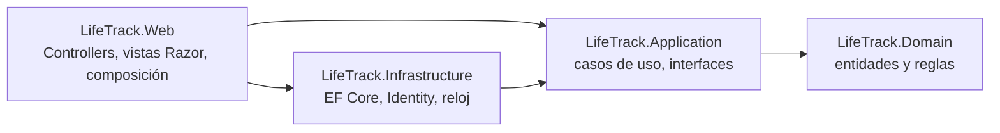
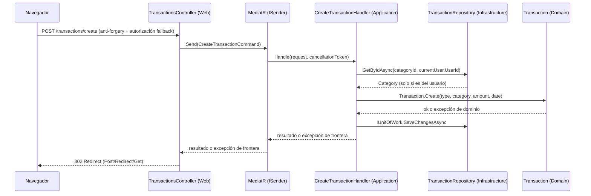

# Arquitectura

LifeTrack sigue **Clean Architecture**: el negocio está en el centro y no conoce ni la base de datos, ni la web, ni los frameworks.

## 1. Capas y regla de dependencias



**Regla:** las dependencias de código fuente apuntan solo hacia dentro. Se verifica automáticamente en `LifeTrack.Architecture.Tests`.

| Proyecto | Referencia a | Paquetes NuGet |
|---|---|---|
| `LifeTrack.Domain` | nada | ninguno |
| `LifeTrack.Application` | Domain | **MediatR** (`13.*`) |
| `LifeTrack.Infrastructure` | Application | EF Core SqlServer, Identity.EntityFrameworkCore |
| `LifeTrack.Web` | Application, Infrastructure | MediatR, Identity.UI, EF Core Design (solo herramientas) |

`Application` mantiene el núcleo libre de frameworks de infraestructura: su único paquete es
`MediatR`, que aporta los contratos del dispatcher y arrastra
`Microsoft.Extensions.DependencyInjection.Abstractions` como dependencia transitiva. El núcleo ya **no
compila sin acceso a internet**: `dotnet restore` necesita NuGet (ADR-0004).

La clave de licencia de MediatR se lee de `MediatR:LicenseKey` en la configuración y **solo es
necesaria en despliegues de producción**. En desarrollo, CI/CD, staging, QA e integración no hace
falta: la ejecución de la licencia es autocontenida (sin servidor de licencias ni llamadas de red) y,
sin clave, la librería solo emite warnings en el log. La clave se guarda como **secret** en App
Settings; nunca en el repositorio.

## 2. Responsabilidades

- **Domain:** entidades, agregados, invariantes y `DomainException`. Código puro y síncrono.
- **Application:** un caso de uso por archivo (el contrato `record` —`ICommand<T>`, `IQuery<T>` o `IRequest`— más sus DTOs y su handler `IRequestHandler<,>`). Define las interfaces que necesita (`ICategoryRepository`, `ITransactionRepository`, `IUnitOfWork`, `ICurrentUser`…). Aplica la autorización por propiedad (filtra por usuario). Publica `ApplicationAssemblyAnchor` para que `Web` pueda escanear este ensamblado.
- **Infrastructure:** implementa persistencia (`AppDbContext`, configuraciones, repositorios, migraciones), Identity y el reloj con zona horaria.
- **Web:** adaptador HTTP con **ASP.NET Core MVC**. Un controller delgado convierte un formulario en un contrato, envía el contrato con `ISender`, convierte el DTO devuelto en un `ViewModel`, y el `ViewModel` en una vista. Las vistas no calculan: renderizan. Aloja la **raíz de composición** (`Program.cs`), el registro de MediatR y la seguridad HTTP. No referencia `Domain`.

### La capa Web por dentro

```
Navegador → [Route] → Controller → ISender (MediatR) → Handler de Application → DTO
                                                       ↓
                                               ViewModel (From)
                                                       ↓
                                         Vista → Parciales → Layout
```

`Domain` queda fuera de la vista. Un `ViewModel` se construye con una fábrica estática `From(...)` a
partir del DTO del handler, y entrega los importes y las fechas ya formateados. Detalle en
`docs/09-estandar-vistas-mvc.md`.

## 3. Flujo de una petición (ejemplo: registrar un movimiento)



El contrato se resuelve **en tiempo de ejecución**: `ISender` busca el `IRequestHandler<CreateTransactionCommand>`
registrado al arrancar. Ese registro lo hace `AddMediatR` escaneando el ensamblado de `Application`
(vía `ApplicationAssemblyAnchor`), no el de `Program`.

La excepción del dominio **no cruza la frontera** y MediatR no cambia esa regla: el handler la
traduce a `BusinessRuleException` o `ResourceNotFoundException`, y solo esas dos llegan al controller.
Cada error tiene un único camino hasta la vista.

La ruta se declara con atributo (`[Route("transactions")]` + `[HttpPost("create")]`). En MVC el
anti-forgery no es automático: lo aplica el filtro global `AutoValidateAntiforgeryToken` registrado
en `Program.cs`.

## 4. Convenciones de carpetas

```
src/LifeTrack.Domain/
  Common/            Entity, Guard
    Exceptions/      DomainException, NotFoundException
  Finance/           Category, Transaction, Budget, TransactionType
src/LifeTrack.Application/
  Abstractions/      ICurrentUser, IUnitOfWork, I…Repository
  Common/            ApplicationAssemblyAnchor, TimeProviderExtensions
    Contracts/       ICommand, IQuery
    Exceptions/      BusinessRuleException, ResourceNotFoundException
  <Agregado>/Commands/ <Command> y <Handler> de cada caso de uso
src/LifeTrack.Infrastructure/
  Persistence/       AppDbContext, ApplicationUser
    Configurations/  IEntityTypeConfiguration<T> por entidad
    Repositories/    implementaciones (internal sealed)
    Migrations/      generadas por dotnet ef
  Time/              ZonedTimeProvider
  DependencyInjection.cs
src/LifeTrack.Web/
  Controllers/       un controller por área
  ViewModels/<Área>/ un modelo por pantalla, solo para pintar
  Views/
    _ViewStart.cshtml, _ViewImports.cshtml
    <Área>/          Index.cshtml, Edit.cshtml, Partials/
    Shared/          _Layout, Partials/, Components/
    Error/
  TagHelpers/        componentes Razor reutilizables
  Security/          cabeceras de seguridad
  Services/          CurrentUserService
  Extensions/        configuración
  wwwroot/           css, js, lib
  Program.cs
```

`Pages/` no pertenece a la aplicación: solo aparece si la UI scaffolded de Identity entra en el
repositorio. Ninguna vista propia vive ahí.

## 5. Patrones y decisiones clave

| Tema | Decisión | Motivo |
|---|---|---|
| Casos de uso | Contratos `ICommand<T>` / `IQuery<T>` / `IRequest` con handlers `IRequestHandler<,>`; MediatR v13 como dispatcher (ADR-0004) | Un `ISender` por controller, behaviors disponibles y convención única; coste: dependencia y licencia |
| Registro | `AddMediatR` escaneando el ensamblado de `Application` vía `ApplicationAssemblyAnchor` | Los handlers viven en `Application`; escanear el de `Program` no los encuentra |
| Persistencia | EF Core directo tras interfaces de repositorio; `DbContext` = `IUnitOfWork` | Simplicidad; cambios atómicos por caso de uso |
| Errores | `Domain` lanza `DomainException` (regla violada, mensaje seguro) y `NotFoundException` (no existe **o** no es tuyo); el handler las traduce a `BusinessRuleException` / `ResourceNotFoundException` con `try`/`catch` explícito, y `Web` solo captura esas | Respuestas uniformes que no filtran información, sin que `Web` tenga que referenciar `Domain`; MediatR no cambia esta frontera (`IRequestExceptionHandler<,,>` queda como opción futura) |
| Autorización de datos | El repositorio recibe `userId` y lo incluye en la consulta | Evita IDOR por construcción |
| Tiempo | `TimeProvider` + zona configurable (`ZonedTimeProvider`) | Tests deterministas; "hoy" correcto aunque el servidor esté en UTC |
| Ids | `Guid` generado en el dominio + `ValueGeneratedNever()` | Evita que EF trate a los hijos nuevos como existentes |
| UI | ASP.NET Core MVC con vistas Razor (ADR-0002) | Vistas con una capa `ViewModel` explícita; parciales y layout con sitio fijo |
| Mapeo | Manual: proyecciones LINQ/`Select` y fábricas `ViewModel.From(...)` | Sin AutoMapper; explícito y fácil de depurar |
| Validación | DataAnnotations en `InputModel` (forma) + invariantes en el dominio (negocio) | Defensa en profundidad |
| Anti-forgery | `AutoValidateAntiforgeryToken` como filtro global | En MVC no es automático; el filtro lo cubre en todos los POST |
| Licencias | Clave de MediatR solo en producción, desde configuración (`MediatR:LicenseKey`), como secret | La Community License cubre uso personal y educativo; la ejecución de la licencia es autocontenida y sin clave solo avisa por log |
| Estilos | CSS propio *mobile-first* en `wwwroot/css`, sin pipeline de build | Sin cadena de herramientas de JS; caben en la capa gratuita |

## 6. Cómo crece la arquitectura
- **Nuevo caso de uso:** crea una carpeta propia en `Application/<Agregado>/Commands/<CasoDeUso>/`, con el comando y su handler juntos en archivos separados. El registro es automático: `AddMediatR` ya escaneó el ensamblado de `Application` al arrancar.
- **Nueva entidad:** clase en `Domain`, configuración EF y repositorio en `Infrastructure`, migración.
- **Función de IA (opcional):** una interfaz `ICategorySuggester` en `Application` y su implementación en `Infrastructure` (cliente de GitHub Models mediante `Microsoft.Extensions.AI`), con respaldo por reglas. El dominio no se entera.
- **Tarea programada (opcional):** proyecto `LifeTrack.Functions` que reutiliza `Application` e `Infrastructure`; no duplica reglas.

## 7. Qué verifica el CI sobre la arquitectura
`LifeTrack.Architecture.Tests` comprueba: Domain sin dependencias de otras capas ni de EF/ASP.NET; Application sin Infrastructure/Web/EF/ASP.NET; Infrastructure sin Web; **controllers sin `Domain` ni `Infrastructure`** y sin handlers concretos inyectados; ningún `ViewModel` heredando de `Domain`; handlers `sealed`; y que `Program.cs` siga registrando `AutoValidateAntiforgeryToken` como filtro global y `AddMediatR` con el escaneo del ensamblado de `Application`.
